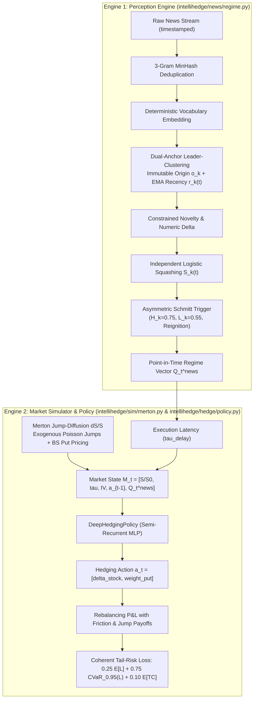

# IntelliHedge

**Point-in-Time News Narrative Intelligence for Autonomous Deep Derivatives Hedging under Market Frictions and Jump Incompleteness**

[](LICENSE)
[](#)
[](#)
[](#)

---

## 1. Executive Summary & Research Thesis

In standard mathematical finance, continuous-time delta hedging replicates contingent claims perfectly only under frictionless, continuous Brownian filtration (Black-Scholes-Merton). In real markets, asset prices exhibit **discontinuous jump arrivals** (incompleteness) and **execution friction** (proportional transaction costs, bid-ask spreads, and latency). Under jump incompleteness, the underlying asset alone cannot span the payoff space; hedging portfolios must incorporate liquid options to manage jump tail risk.

Traditional algorithmic execution models respond to jump shocks *reactively*—after prices gap and implied volatility spikes in the "rearview mirror." **IntelliHedge** evaluates whether **point-in-time unstructured narrative intelligence**, distilled through an online perception engine, enables deep reinforcement learning policies to dynamically adjust stock and option hedges *prior* to and *during* exogenous market jump clusters.

### The Four Non-Negotiable Separations (Scientific Integrity Protocol)

To eliminate circular reasoning (the "tautology trap" where simulated price jumps are triggered by the exact news signal fed to the policy), IntelliHedge enforces four architectural boundaries:

| Separation | Methodological Rule |
| :--- | :--- |
| **1. Measurement Separation** | Narrative strength $S_k(t)$ is computed strictly from news headline text. Market prices, returns, implied volatility, and P&L never enter the perception engine or its Schmitt trigger thresholds. |
| **2. Dynamics Separation** | Synthetic jump-diffusion paths follow an exogenous Poisson shock schedule calibrated independently from historical crisis volatility, never as a function of $S_k(t)$. |
| **3. Execution Separation** | Strictly point-in-time information ordering: at decision step $t$, the policy only observes articles published at or before $t$. Includes an explicit latency parameter $\tau_{\text{delay}}$. |
| **4. Hedging Separation** | Because jump markets are incomplete, the model is evaluated as an approximate risk-minimizer over a short ATM Put liability using stock plus liquid near-the-money Put options. |

---

## 2. Mathematical & Algorithmic Architecture



### 2.1 Engine 1: Point-in-Time Perception (`intellihedge/news/regime.py`)

1. **3-Gram Shingle Deduplication:** Filters syndicated clone headlines (e.g., wire duplicates from AP/Reuters/CNBC) using Jaccard similarity over word tri-grams:
   $$\text{Jaccard}(A, B) = \frac{|A \cap B|}{|A \cup B|} \ge 0.80 \implies \text{Drop}$$
2. **Dual-Anchor Leader-Clustering:** For each active narrative cluster $k$:
   - **Immutable Origin Anchor** $o_k$: Fixed to the embedding of the first breaking headline, preventing semantic drift over months.
   - **Recency Centroid** $r_k(t)$: Updated via exponential moving average:
     $$r_k(t^+) = \frac{(1 - \alpha) r_k(t^-) + \alpha e_i}{\|(1 - \alpha) r_k(t^-) + \alpha e_i\|_2}$$
3. **Constrained Novelty & Numeric Fact Delta:**
   - Dual Affinity: $A_k(i) = 0.6 \cos(e_i, o_k) + 0.4 \cos(e_i, r_k(t))$
   - Freshness: $F_k(i) = \max\left(0, 1 - \max_{j \in \text{recent}} \cos(e_i, e_j)\right)$
   - Numeric Fact Delta: $d_{\text{num}}(i, k) = 1 - \exp\left(-\frac{|\text{num}_t - \text{num}_{\text{prev}}|}{\text{num}_{\text{prev}} + 10}\right)$
   - Novelty Contribution:
     $$N(i, k) = A_k(i) \cdot F_k(i) \cdot \left(1 + 0.85 \cdot d_{\text{num}}(i, k)\right)$$
4. **Independent Logistic Squashing:**
   $$z_k(t) = b_0 + b_1 \cdot \text{novelty\_mass} + b_2 \cdot \text{source\_entropy} + b_3 \cdot \text{max\_num\_shock} + b_4 \cdot S_k(t-1)$$
   $$S_k(t) = \frac{1}{1 + e^{-z_k(t)}}$$
   *Note: Computed independently per narrative—never a cross-narrative softmax—allowing multiple simultaneous macro crises.*
5. **Asymmetric Schmitt Trigger & State Machine:**
   - Enter `DOMINANT` when $S_k(t) \ge H_k$ ($0.75$)
   - Exit to `FADING` only when $S_k(t) \le L_k$ ($0.55$)
   - `REIGNITION` flag: Raised when transitioning from `FADING` directly back to `DOMINANT`.
   - Trend: Filtered rate-of-change $\text{EMA}(dS/dt)$ classifying into `RISING`, `FALLING`, or `STABLE`.
6. **Emitted Regime Vector:**
   $$Q_t^{\text{news}} = \left[S_k(t), \; \text{state\_num}, \; \text{trend\_num}, \; \text{novelty\_mass}\right]^\top \in \mathbb{R}^4$$

---

### 2.2 Engine 2: Merton Jump-Diffusion & Option Pricing (`intellihedge/sim/merton.py`)

Asset price paths follow Merton's jump-diffusion SDE:
$$\frac{dS_t}{S_{t-}} = (\mu - \lambda \kappa) dt + \sigma dW_t + (J - 1) dN_t$$
where:
- $N_t \sim \text{Poisson}(\lambda t)$ is an exogenous jump counting process.
- $\ln J \sim \mathcal{N}(\mu_J, \sigma_J^2)$ is the log-normal jump size distribution.
- $\kappa = \mathbb{E}[J - 1] = \exp(\mu_J + \frac{1}{2}\sigma_J^2) - 1$ is the drift compensator.
- Vectorized Black-Scholes pricing and delta are evaluated at every discrete step for a liquid near-the-money protective Put option ($K_{\text{hedge}} = 98$).
- Implied volatility reflects post-jump feedback: $\text{IV}_{t+1} = \text{clip}\left(\sigma_0 + 0.35 \cdot \mathbf{1}_{\text{jump}} + 0.5(\text{IV}_t - \sigma_0), 0.18, 0.75\right)$.

---

### 2.3 Deep Hedging Policy & Causal Ablation (`intellihedge/hedge/policy.py`)

- **State Space:** $M_t = \left[S_t / S_0, \; \tau_t, \; \text{IV}_t, \; a_{t-1}^{\text{stock}}, \; a_{t-1}^{\text{put}}, \; Q_t^{\text{news}}\right]^\top \in \mathbb{R}^9$
- **Action Space:** $a_t = \left[\delta_t^{\text{stock}} \in [0, 1], \; w_t^{\text{put}} \in [0, 1.25]\right]^\top$
- **Coherent Tail-Risk Loss Objective:**
  $$\min_\theta \; \mathcal{L}(\theta) = 0.25 \mathbb{E}[L_T(\theta)] + 0.75 \text{CVaR}_{0.95}(L_T(\theta)) + 0.10 \mathbb{E}[\text{TC}(\theta)]$$
  where $\text{CVaR}_\alpha(L) = \frac{1}{1-\alpha} \int_\alpha^1 \text{VaR}_u(L) du$.

#### 4-Arm Causal Ablation Protocol
To isolate causal signal from parameter capacity confounds:
1. **Arm A (Market-Only Baseline):** $Q_t^{\text{news}} = \mathbf{0}$. Policy must hedge using only price and volatility history.
2. **Arm B (News-Aware Treatment):** Policy receives real point-in-time $Q_t^{\text{news}}$.
3. **Arm C (Shuffled-News Placebo):** $Q_t^{\text{news}}$ is randomly permuted along the time axis. If Arm B outperformed merely due to extra network capacity, Arm C would match Arm B. Failing to do so proves true temporal causal efficacy.
4. **Arm D (Latency-Stressed):** $Q_t^{\text{news}}$ is lagged by 1 time step ($t-1$), quantifying execution friction and latency decay.

---

## 3. Repository Structure

```
IntelliHedge/
├── config.yaml                # Single source of truth for all experiment parameters
├── intellihedge/
│   ├── news/regime.py         # Engine 1: Point-in-time news perception, dedup, Schmitt trigger
│   ├── sim/merton.py          # Engine 2: Merton Jump-Diffusion simulation, BS put pricing
│   ├── hedge/policy.py        # Policy network & 4-Arm Causal Ablation runner
│   └── eval/harness.py        # Multi-seed, 100k-path evaluation with paired bootstrap CIs
├── tests/                     # pytest
├── docs/phase0/               # Phase 0 deliverables (results, related work, memos)
├── main.py                    # Fast CLI demo runner, telemetry tables, dashboard export
├── app.py                     # Streamlit interactive dashboard
├── ROADMAP.md                 # 12-month roadmap v2
└── requirements.txt
```

---

## 4. Quickstart & Installation

### Requirements
- Python 3.10+
- PyTorch 2.x
- NumPy, SciPy, Matplotlib, Streamlit
- **Zero API keys or external services required.** All semantic representations and market paths run offline deterministically.

```bash
# Clone the repository
git clone https://github.com/krishivwahi/IntelliHedge.git
cd IntelliHedge

# Install dependencies
pip install -r requirements.txt
```

---

## 5. Execution

### 5.1 CLI Runner (`main.py`)
Runs the complete perception and hedging pipeline across all 4 experimental arms in **~8 seconds**, outputs formatted telemetry tables, and exports `intellihedge_dashboard.png`.

```bash
python main.py
```

#### Sample Telemetry Output:
```text
============================================================================================
  INTELLIHEDGE — Point-in-Time News Narrative Intelligence for Deep Derivatives Hedging
============================================================================================

[ENGINE 1] Point-in-Time News Regime Trajectory (US-Iran Hormuz Replay)
Step   | S_k(t)     | State      | Trend    | Novelty    | Event Note
--------------------------------------------------------------------------------------------
t=0    | 0.605      | FADING     | RISING   | 1.425      | 
t=1    | 0.377      | FADING     | STABLE   | 0.250      | 
t=2    | 0.772      | DOMINANT   | RISING   | 0.771      | ** REIGNITION **
t=3    | 0.800      | DOMINANT   | RISING   | 0.740      | SHOCK CLUSTER
t=4    | 0.786      | DOMINANT   | STABLE   | 0.604      | SHOCK CLUSTER
t=5    | 0.400      | FADING     | FALLING  | 0.165      | 
t=6    | 0.521      | FADING     | STABLE   | 0.334      | 
t=7    | 0.363      | FADING     | FALLING  | 0.266      | 
t=8    | 0.426      | FADING     | STABLE   | 0.299      | 
t=9    | 0.344      | FADING     | FALLING  | 0.265      | 
t=10   | 0.792      | DOMINANT   | RISING   | 0.961      | ** REIGNITION **
t=11   | 0.806      | DOMINANT   | RISING   | 0.780      | SHOCK CLUSTER
t=12   | 0.484      | FADING     | FALLING  | 0.249      | 
t=13   | 0.357      | FADING     | FALLING  | 0.277      | 
t=14   | 0.535      | FADING     | RISING   | 0.304      | 

[ENGINE 2] Causal Ablation Benchmark — Out-of-Sample Test Paths
Arm                                  |  Mean P&L |  95% CVaR |  99% CVaR |  Max Loss
--------------------------------------------------------------------------------------------
Arm A: Market-Only (Baseline)        |    +2.530 |     0.929 |     1.273 |     1.787
Arm B: News-Aware (IntelliHedge)     |    +2.811 |     0.714 |     1.398 |     1.670
Arm C: Shuffled-News (Placebo)       |    +2.646 |     0.987 |     1.363 |     1.886
Arm D: Latency-Stressed (1-step)     |    +2.757 |     1.022 |     1.544 |     2.157
--------------------------------------------------------------------------------------------
  --> Tail-Risk (95% CVaR) reduction -- Arm B vs A : +23.1%
  --> Max Loss reduction        -- Arm B vs A : +6.5%
  --> Placebo check (Arm C vs B): 95% CVaR 0.987 vs 0.714 (destroys causal timing)
  --> Latency cost  (Arm D vs B): 95% CVaR 1.022 vs 0.714 (1-step delay degrades edge)

[DASHBOARD] Saved → intellihedge_dashboard.png
[OK] Total runtime: 8.2s
```

---

### 5.2 Streamlit Interactive Dashboard (`app.py`)
Launch the real-time dark-themed monitoring interface with live interactive sliders:

```bash
streamlit run app.py
```

**Interactive Controls:**
- $H_k$ (DOMINANT threshold slider: `0.60` - `0.95`)
- $L_k$ (FADING exit threshold slider: `0.35` - `0.70`)
- $\alpha$ (EMA recency centroid smoothing)
- Transaction cost sliders (Stock & Put rebalancing fees in bps)
- Training epochs (`20` - `100`)

---

## 6. Generated Visual Telemetry

The 4-panel dashboard (`intellihedge_dashboard.png`) generated by `main.py` provides:
1. **Schmitt Trigger State Hysteresis:** Trajectory of $S_k(t)$ relative to $H_k$ and $L_k$, highlighting DOMINANT intervals and REIGNITION pulses.
2. **Dynamic Protective Put Allocation:** Time-series of mean Put holdings $w_t^{\text{put}}$ across all 4 experimental arms. Notice how Arm B preemptively expands put protection during news escalation windows.
3. **Terminal P&L Left-Tail Truncation:** Out-of-sample hedging loss distribution comparing Arm A (unprotected tail) with Arm B (left-tail truncated).
4. **Causal Ablation Comparison:** Bar chart quantifying 99% CVaR tail loss across Arms A, B, C, and D.

---

## 7. Authors & Research Roadmap

- **Krishiv Wahi** (Lead Quantitative Developer & ML Architect)
- **Kamya Aggarwal**
- **Sarthak Shandiliya**

Prepared as part of the *News-Regime-Conditioned Deep Hedging 24-Month Research Roadmap* (ICAIF Submission Track).

